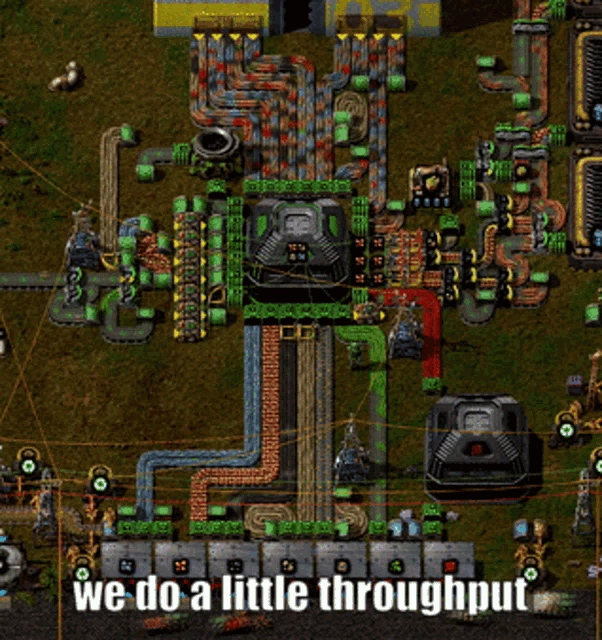

 

## 👋 About

- 🎓 **Yonsei University** — Nano Science & Engineering (semiconductors) × Economics / Finance
- 📈 Quant & algorithmic trading — KRX / US markets, backtesting, RSI-based strategies
- 🤖 Automation addict — if I do it twice, I script it (Playwright, scrapers, bots)
- 🏎️ Founder of a F1 / motorsports club · 🇰🇷 🇬🇧 bilingual (grew up across Germany, China, Korea)
- 📚 Currently: algo trading · neural networks · electromagnetics (Griffiths)

## 🛠 Favorite Tools of Choice

  
  
  
  

  
  
  
  
  
  

## 📌 Projects

| | Project | What it does |
|---|---|---|
| 📰 | [**read_news_and_trade**](https://github.com/mortalist/read_news_and_trade) | Reads financial news, guesses bullish / bearish, and trades |
| 💹 | [**KISTrader_project**](https://github.com/mortalist/KISTrader_project) | US stock trading via KIS OpenAPI |
| 🚌 | [**Auto_Yonsei_bus**](https://github.com/mortalist/Auto_Yonsei_bus) | Automatically reserves campus buses |
| 🧠 | [**neural-net-final**](https://github.com/mortalist/neural-net-final) | Neural network final project |
| 📊 | [**excel-side-by-side**](https://github.com/mortalist/excel-side-by-side) | Side-by-side comparison of two Excel columns |
| ⌨️ | [**planck-base**](https://github.com/mortalist/planck-base) | Personal QMK keymap for Planck rev6 — Win/Mac toggle, tap-hold combos, Hangul support |
| 🤝 | [**trainthon-MyHR**](https://github.com/mortalist/trainthon-MyHR) | Hackathon project — AI that remembers your network |

## 📊 GitHub Stats

 

> *"Dirty Hands!"*

